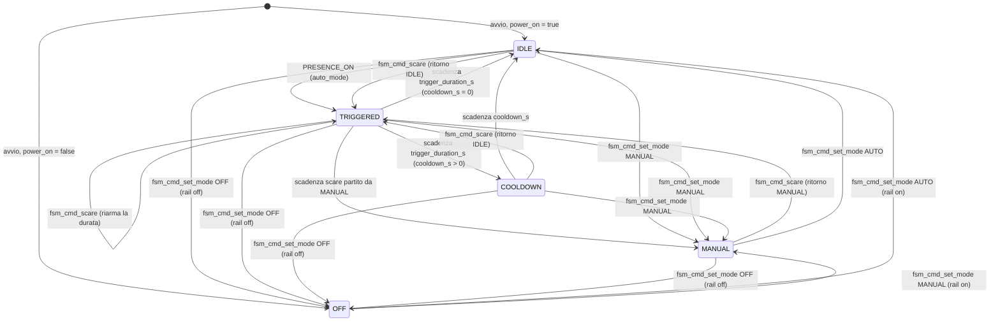

# Macchina a stati della zucca (pumpkin_fsm)

La FSM che lega il radar di presenza agli effetti LED: componenti `pumpkin_fsm` e
`config_store`, consegnati con la Fase 3. La logica di decisione vive nel core puro
[fsm_core.c](../components/pumpkin_fsm/fsm_core.c) (testabile su host, orologio
iniettato); il layer IDF ([fsm.c](../components/pumpkin_fsm/fsm.c), integrazione) possiede
la coda e il task, chiama `led_effects` e traduce la persistenza su `config_store`.
Contratti: [pumpkin_fsm.h](../components/pumpkin_fsm/include/pumpkin_fsm.h),
[fsm_core.h](../components/pumpkin_fsm/fsm_core.h),
[config_store.h](../components/config_store/include/config_store.h).

Flusso: `radar_ld2420` pubblica `PRESENCE_EVENT` sul loop di default → la FSM transita →
ogni effetto collaterale esce come `fsm_output_t` (effetto + colore + luminosità, rail,
timer, persistenze) e il layer IDF lo applica su `led_effects`. Le decisioni di
progetto sono in [ADR-007](wiki/decisioni/adr-007-fsm-config-store.md); le pagine wiki:
[pumpkin_fsm](wiki/componenti/pumpkin_fsm.md), [config_store](wiki/componenti/config_store.md).

## Stati

| Stato | Significato | Look a video |
| --- | --- | --- |
| `IDLE` | attesa presenza | `idle_anim` (default `candle`) a `idle_brightness_pct` |
| `TRIGGERED` | scare in corso, durata fissa | `trigger_anim` (default `scare`) a `brightness_pct` |
| `COOLDOWN` | scare finito, presenza ignorata | look idle |
| `MANUAL` | guida utente, logica automatica sospesa | look manuale (seed: look corrente) |
| `OFF` | rail LED spento | nessuno |

Il colore (default 255/120/0) è condiviso da tutti i look; ogni emissione riporta
**effetto + colore + luminosità** (scala 0–255, con cap `max_brightness_pct`, default 60).

## Diagramma

Non compaiono transizioni: `PRESENCE_OFF` non ha mai effetto (la durata del trigger è
fissa, la presenza non la accorcia); `PRESENCE_ON` in `COOLDOWN`/`MANUAL`/`OFF` (o con
`auto_mode` falso) è ignorato; `CONFIG_EVENT_CHANGED` rinfresca il look senza cambiare
stato; `set_mode AUTO` da `IDLE`/`TRIGGERED`/`COOLDOWN` è un no-op (la deadline corsa
viene preservata).

## Tabella delle transizioni

Stato corrente × input → nuovo stato e azioni. "Timer" indica il riarmo dell'unico
one-shot (`timer_valid` + `timer_ms`; 0 = cancellazione).

| Stato | Input | Nuovo stato | Azioni |
| --- | --- | --- | --- |
| IDLE | `PRESENCE_ON` (auto) | TRIGGERED | look trigger, timer = `trigger_duration_s`, ritorno = IDLE |
| TRIGGERED | scadenza timer, ritorno IDLE | COOLDOWN (se `cooldown_s` > 0) | look idle, timer = `cooldown_s` |
| TRIGGERED | scadenza timer, `cooldown_s` = 0 | IDLE | look idle, timer cancellato |
| TRIGGERED | scadenza timer, ritorno MANUAL | MANUAL | look manuale, timer cancellato |
| COOLDOWN | scadenza timer | IDLE | look idle, timer cancellato |
| TRIGGERED | `fsm_cmd_scare` | TRIGGERED | solo riarmo della durata |
| IDLE/COOLDOWN | `fsm_cmd_scare` | TRIGGERED | look trigger, timer, ritorno = IDLE |
| MANUAL | `fsm_cmd_scare` | TRIGGERED | look trigger, timer, ritorno = MANUAL |
| qualsiasi ≠ OFF | `set_mode OFF` | OFF | rail off, timer cancellato, `power_on` → false |
| qualsiasi ≠ MANUAL | `set_mode MANUAL` | MANUAL | seed look corrente, rail on, timer cancellato, `power_on` → true |
| MANUAL/OFF | `set_mode AUTO` | IDLE | rail on se partiva da OFF, look idle, timer cancellato |
| IDLE/COOLDOWN | `set_light` / `set_effect` | — | look idle aggiornato **e persistito** (colore + `idle_brightness_pct` / `idle_anim`) |
| TRIGGERED | `set_light` / `set_effect` | — | look trigger aggiornato **e persistito** (colore + `brightness_pct` / `trigger_anim`) |
| MANUAL | `set_light` / `set_effect` | — | look manuale aggiornato, **transiente** (nessuna persistenza) |
| OFF | `set_light` / `set_effect` / `scare` | — | **rifiutato** (`ESP_ERR_INVALID_STATE`, log; nessun cambiamento) |
| qualsiasi | `CONFIG_EVENT_CHANGED` | — | rinfresca il look dello stato corrente; in OFF nessun output; `power_on` non viene letto (è solo politica di boot) |

Comportamenti da notare:

- Entrare in `MANUAL` **semina** il look manuale con quello a video: da `TRIGGERED`
  parte col look trigger, altrimenti col look idle; i comandi luce/effetto poi lo
  modellano senza toccare la configurazione.
- `scare` in `MANUAL` e ritorno: la presentazione manuale torna identica alla scadenza.
- Il cooldown mostra il look idle con `PRESENCE_ON` ignorato: nessun re-trigger finché
  non scade (`cooldown_s` = 0 lo disattiva: da `TRIGGERED` si torna diretti a `IDLE`).
- In `OFF` la FSM continua a girare (accoda comandi, accetta `set_mode`): solo gli
  output di luce sono soppressi e il rail resta spento.

## Tempi

- `trigger_duration_s`: default **8 s** (Kconfig, range 1–3600) — durata del look trigger.
- `cooldown_s`: default **30 s** (range 0–3600) — pausa minima tra due trigger.
- Un solo deadline armato alla volta: il core ricalcola la scadenza assoluta (µs
  dall'orologio iniettato) a ogni input; sul target un **`esp_timer` one-shot** post
  un wake-up `FSM_IN_POLL` nella coda FSM, il core confronta l'orologio e esegue la
  transizione. Gli stati senza scadenza emettono la cancellazione esplicita del timer
  (`timer_valid` = true, `timer_ms` = 0): il layer IDF non lascia mai un one-shot
  vecchio armato. Al boot il timer parte disarmato.
- Durate in secondi convertite in ms per il timer e in µs per il deadline: tutta la
  matematica del tempo usa `esp_timer_get_time()` (µs), mai tick (vedi
  [insidia tick](wiki/insidie/freertos-tick-100hz.md) per la lezione analoga sui delay).

## Modello di configurazione

`config_store` è la fonte unica di verità ([pagina](wiki/componenti/config_store.md),
[header](../components/config_store/include/config_store.h)): copia RAM protetta da
mutex, scrittura NVS namespace **`pumpkin`** (chiavi `ver` + `cfg`, blob v1
little-endian senza padding) rimandata da un **debounce di 2000 ms**
(`CONFIG_STORE_DEBOUNCE_MS`, `esp_timer` one-shot riarmato a ogni modifica;
`cfg_flush` committa subito). Ogni `set_*` valida, aggiorna la RAM e pubblica
**subito** `CONFIG_EVENT_CHANGED` con payload `config_change_t{id}`; un set con valore
identico è un no-op (né evento né commit): il loop-back della FSM è idempotente.

Parametri (default = Kconfig di [config_store](../components/config_store/Kconfig)):

| Parametro | Default | Note |
| --- | --- | --- |
| `trigger_mm` | 1200 (100–10000) | soglia radar in AUTO (sync verso `radar_ld2420`, [ADR-007](wiki/decisioni/adr-007-fsm-config-store.md)) |
| `cooldown_s` | 30 (0–3600) | 0 = cooldown disattivato |
| `trigger_duration_s` | 8 (1–3600) | durata del trigger |
| `trigger_anim` / `idle_anim` | `scare` / `candle` | nomi del registry `led_effects` |
| `idle_brightness_pct` | 10 (0–100) | look idle/cooldown |
| `brightness_pct` | 100 (0–100) | look trigger |
| `max_brightness_pct` | 60 (5–100) | cap di sicurezza su **ogni** look |
| colore RGB | 255/120/0 | condiviso dai look |
| `auto_mode` | true | false: `PRESENCE_ON` non triggera |
| `power_on` | true | politica di boot (sotto) |

All'avvio `config_store_init` carica il blob, lo **migra** alla versione corrente
(v1; versione futura → `ESP_ERR_NOT_SUPPORTED`) e lo **sanifica** (clamp dei range,
stringhe terminate, nomi effetto vuoti o troppo lunghi corretti); in assenza di blob
valido valgono i default Kconfig. `CONFIG_ANIM_NAME_LEN` = 16 caratteri. I nomi effetto
non sono validati contro il registry alla scrittura: la validazione avviene al consumo
(vedi [domande aperte](wiki/domande-aperte.md)).

## Semantica dei comandi

Le API (`fsm_cmd_set_mode/set_light/set_effect/scare`) **accodano** al task
proprietario: il ritorno riporta solo errori di accodamento, l'accettazione dipendente
dallo stato è decisa dal core nel task (rifiuti loggati). Riepilogo:

| Comando | AUTO (IDLE/TRIGGERED/COOLDOWN) | MANUAL | OFF |
| --- | --- | --- | --- |
| `set_mode AUTO` | no-op (deadline preservata) | rientra IDLE | rientra IDLE, rail on |
| `set_mode MANUAL` | entra MANUAL (seed look corrente) | no-op | entra MANUAL, rail on |
| `set_mode OFF` | rail off, `power_on` → false | rail off, `power_on` → false | no-op |
| `set_light` | aggiorna e **persiste** il look dello stato corrente | transiente | rifiutato |
| `set_effect` | aggiorna e **persiste** `idle_anim`/`trigger_anim` | transiente | rifiutato |
| `scare` | TRIGGERED (ritorno IDLE; in TRIGGERED riarma) | TRIGGERED (ritorno MANUAL) | rifiutato |

Regola di persistenza: in **AUTO** i comandi di luce/effetto scrivono in `config_store`
(la scelta sopravvive al reboot); in **MANUAL** modellano solo il look corrente
(transiente). `set_mode OFF/MANUAL` aggiornano anche `power_on` persistito; `set_mode
AUTO` non lo tocca.

## Politica di persistenza al boot

`pumpkin_fsm_init` carica la configurazione e decide lo stato iniziale dal campo
persistito `power_on`: **true → `IDLE`** (rail on + look idle), **false → `OFF`** (solo
rail off, nessun look). Non c'è ripristino dello stato precedente al power-off: la
zucca riparte sempre da `IDLE` o `OFF` (decisione in [ADR-007](wiki/decisioni/adr-007-fsm-config-store.md)).
`fsm_core_boot` emette l'accensione del rail e il look iniziale; il timer parte disarmato.

## Verifica a banco

App di test: `test_apps/pumpkin_fsm` (console `esp_console` al prompt `fsm>` su UART0,
vedi [flash e monitor](wiki/procedure/flash-monitor.md)). Comandi:

| Comando | Effetto |
| --- | --- |
| `fsm_state` | stampa stato corrente |
| `fsm_mode auto\|manual\|off` | comando di modalità |
| `fsm_scare` | scare manuale |
| `fsm_light <r> <g> <b> <pct>` | comando luce (RGB 0–255, percentuale 0–100) |
| `fsm_anim <nome>` | comando effetto (nome registry) |
| `cfg_get` | dump leggibile della configurazione corrente |
| `cfg_set  <v> [...]` | scrive un parametro (evento + debounce NVS); sottocomandi: `trigger_mm`, `cooldown_s`, `duration_s`, `idle_bright`, `max_bright`, `bright`, `auto <0\|1>`, `color`, `trigger_anim`, `idle_anim` |
| `cfg_flush` | committa subito le modifiche pendenti |

Sequenza attesa del ciclo automatico (default 8 s + 30 s):

1. `t=0` — app in `IDLE`: `fsm_state` stampa `state=IDLE (0)`, look candle al 10%.
2. Avvicinare un bersaglio al radar sotto 1200 mm → `PRESENCE_ON` → `TRIGGERED`:
   log `I (<tick>) app: <ms> ms: fsm IDLE -> TRIGGERED` e look scare.
3. `t≈8 s` — scadenza `trigger_duration_s` → `fsm TRIGGERED -> COOLDOWN`, look candle.
   In questa finestra avvicinare di nuovo il bersaglio **non** deve ri-triggerare
   (`PRESENCE_ON` in cooldown è ignorato).
4. `t≈38 s` — scadenza `cooldown_s` → `fsm COOLDOWN -> IDLE`; ora un nuovo
   `PRESENCE_ON` ri-triggera.

Ogni cambiamento di parametro logga `app: <ms> ms: cfg <param> changed`; in più,
l'app inoltra `trigger_mm` al radar a ogni cambio
([ADR-007](wiki/decisioni/adr-007-fsm-config-store.md)).

Extra da provare: `fsm_mode off` (rail spento, poi `fsm_mode auto` riaccende),
`fsm_scare` da `MANUAL` (torna al look manuale), `cfg_set duration_s 3` + `cfg_flush`
e ri-trigger per vedere la durata corta, reboot entro 2 s da un `cfg_set`
(la modifica si perde: debounce) e dopo (sopravvive). Stati attesi confermabili con
`fsm_state` a ogni passo.

**Stato della verifica**: logica di transizione e persistenza del core sono verificate
su host (27 test FSM + 13 test config_store, verdi); tempi reali su board, persistenza
dopo reboot e il cablaggio radar→FSM→LED restano da confermare a banco (vedi
[domande aperte](wiki/domande-aperte.md)).
