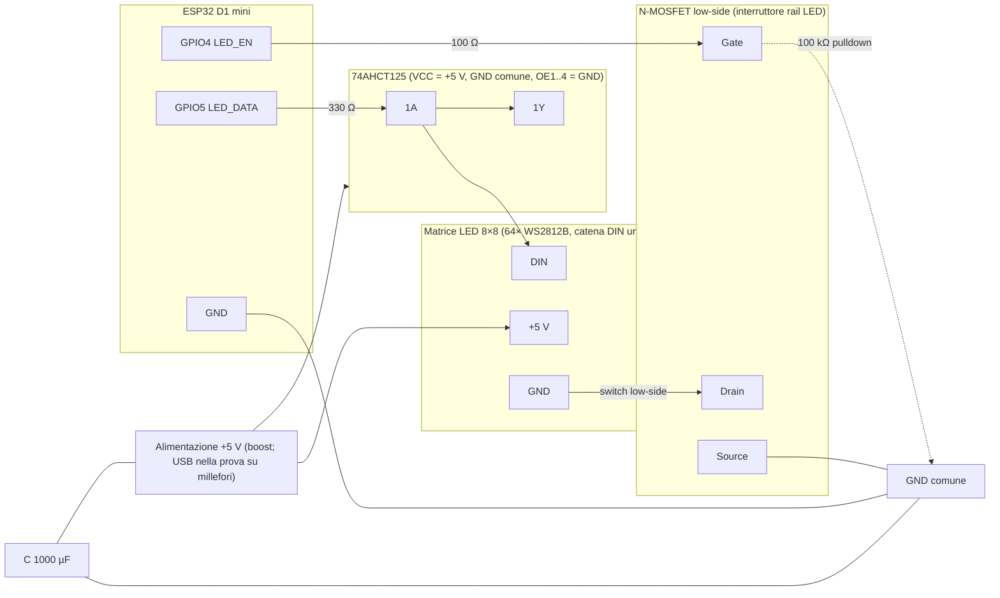
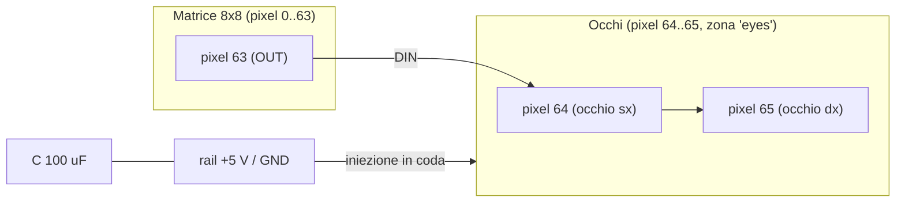

# Pinout e cablaggio LED — Fase 1, occhi dalla Fase 8

## Schema di cablaggio

```text
ESP32 D1 mini                 74AHCT125 (VCC=5V, GND comune, OE1..4=GND)
  GPIO5 (LED_DATA) ──[330 Ω]── 1A          1Y ────► DIN matrice 8×8 (64× WS2812B, catena unica)
  GPIO4 (LED_EN) ──[100 Ω]─────────────────► Gate N-MOSFET (interruttore rail LED)
                                             100 kΩ tra Gate e GND (pulldown)
Rail LED: +5 V dal boost ──► matrice; GND matrice ──► Drain MOSFET, Source ──► GND (switch low-side)
Condensatore 1000 µF tra +5 V e GND del rail, vicino al primo pixel.
```

> **Ipotesi**: interruttore low-side con N-MOSFET; se il MOSFET è high-side (P o driver dedicato), il Gate va pilotato di conseguenza — adattare senza cambiare il firmware (LED_EN attivo alto in entrambi i casi).

Diagramma visivo dello stesso cablaggio:



## Tabella pin

| Segnale  | GPIO | Direzione | Funzione                                                            | Kconfig (default nel menuconfig) |
| -------- | ---- | --------- | ------------------------------------------------------------------- | -------------------------------- |
| LED_DATA | 5    | output    | linea dati della matrice (catena DIN unica), via buffer 74AHCT125 (dopo la resistenza da 330 Ω) | `LED_FX_DATA_GPIO` (default 5)   |
| LED_EN   | 4    | output    | gate del MOSFET che abilita il rail LED (attivo alto)               | `LED_FX_EN_GPIO` (default 4)     |

I default sono definiti nel `Kconfig` del componente `led_effects` e modificabili da `idf.py menuconfig`.

## Occhi (Fase 8): 2 WS2812B in coda alla catena

I due LED degli occhi sono **dello stesso tipo** dei 64 del corpo (protocollo, tensione
e ordine colore identici) e sono collegati **in serie in coda alla stessa catena dati**,
senza GPIO aggiuntivi:

- **Indici 0-based 64 e 65** (cioè il **65° e il 66° LED** della catena);
  `CONFIG_LED_FX_NUM_PIXELS` = **66** e `CONFIG_LED_FX_EYES_START` = **64** (Kconfig
  del componente, entrambi fissati anche in `sdkconfig.defaults`).
- Alimentati dal **rail LED** (dopo il MOSFET di `LED_EN`): a rail spento restano spenti
  come il corpo.
- Il motore li tratta come **zona occhi** (`fx_eyes.c`): effetti propri, luminosità
  propria, stessi gamma/cap/limitazione del corpo — vedi [ADR-010](wiki/decisioni/adr-010-occhi-zone.md).

Cablaggio consigliato (la catena dati esiste già: OUT del pixel 63 → DIN del pixel 64):

- **Iniezione di alimentazione in coda**: portare +5 V e GND del rail anche **vicino agli
  occhi** (allo spavento assorbono fino a ~120 mA e sono i più lontani dalla sorgente:
  con tutta la catena a bianco pieno la caduta sui 64 pixel a monte è massima).
- **Condensatore 100 µF** tra +5 V e GND vicino agli occhi (il 1000 µF esistente sta a inizio catena).
- Se il collegamento dal pixel 63 agli occhi supera **~30 cm**: cavo **intrecciato dato+GND**,
  eventuale **resistenza serie sul dato** (100–330 Ω vicino al pixel 64) — *distanza da
  confermare in fase di montaggio*.



## Sequenze di alimentazione (implementate dal motore)

- **ON**: `LED_EN` alto → attesa 20 ms → primo frame renderizzato (il frame esce nella stessa iterazione del task `anim`).
- **OFF**: frame nero (`led_strip_clear` + `led_strip_refresh`) → `LED_EN` basso.
- **A rail spento** la linea dati resta bassa (RMT idle): i LED non vengono alimentati dal pin dati durante lo spegnimento.

## Assunzioni hardware dichiarate

- Catena **66× WS2812B**: 64 della matrice 8×8 + 2 occhi in coda (Fase 8); conteggio da
  `CONFIG_LED_FX_NUM_PIXELS` (default **66**), unica fonte di verità, zona occhi da
  `CONFIG_LED_FX_EYES_START` (default 64). Tipo LED degli occhi = stesso dei pixel del
  corpo (confermato utente 2026-10-27).
- Ordine canali **GRB** (default, `CONFIG_LED_FX_ORDER_GRB`); variante SK6812 RGBW opzionale via `CONFIG_LED_FX_RGBW`.
- **Mappatura serpentina row-major, origine alto-sinistra** (pixel 0 = x0,y0; righe pari sx→dx, righe dispari dx→sx):
  `index = y*8 + (y pari ? x : 7-x)` — **assunto da verificare al banco**: con il comando console
  `pixel <x> <y> <r> <g> <b>` accendere i quattro angoli e i primi pixel delle righe 0/1; se l'ordine
  reale differisce si corregge solo la mappatura software (`led_fx_xy_index`), non il cablaggio.
- Corrente assorbita da un canale a piena scala: **20 mA** (`FX_MA_PER_CHANNEL`, base della stima software di corrente).

## Misura corrente di banco

Procedura: multimetro in serie sul **+5 V del rail LED** (oppure INA219); per ogni scenario leggere la stima con il comando console `current` e confrontarla con il valore misurato.

Scenari:

1. `fx candle` + `bright 26` (~10% di luminosità).
2. `fx solid` + `color 255 255 255` + `bright 255` con cap di luminosità al 60% (`CONFIG_LED_FX_MAX_BRIGHTNESS_PCT`, default) → atteso ~2,38 A (corpo + occhi); per il test al 100% ricompilare l'app con `CONFIG_LED_FX_MAX_BRIGHTNESS_PCT=100` → atteso ~3,96 A.
3. Occhi a piena luce con corpo spento: `eyes effect solid` + `eyes color 255 255 255` + `eyes bright 255` → atteso ~120 mA (2 px × 3 canali × 20 mA).

| Scenario | Stima SW (mA) | Misurato (mA) |
| -------- | ------------- | ------------- |
| `fx candle` + `bright 26` (~10%) | — (da leggere con `current` a banco) | — (da misurare, Fase 8) |
| `fx solid` + `color 255 255 255` + `bright 255` (cap 60%) | 3960 (`current`, frame lineare bianco pieno a scala 100, 66 px) | — (da misurare, Fase 8) |
| come sopra, con `CONFIG_LED_FX_MAX_BRIGHTNESS_PCT=100` | 3960 | — (da misurare, Fase 8) |
| occhi solid bianco pieno, corpo nero | 120 | — (da misurare, Fase 8) |

Nota: la stima software (`current`) è calcolata sul frame lineare prima di gamma/luminosità, quindi non riflette il cap di luminosità dell'uscita; i valori attesi ~2,38 A (cap 60%) e ~3,96 A (cap 100%) si riferiscono alla misura fisica (66 px × 3 canali × 20 mA = 3960 mA a scala 100). Criterio di accettazione Fase 8: tensione al pixel 65 (0-based) a bianco pieno ≥ 4,5 V senza viraggio dei colori; misura con occhi al massimo entro ±15% dalla stima.
